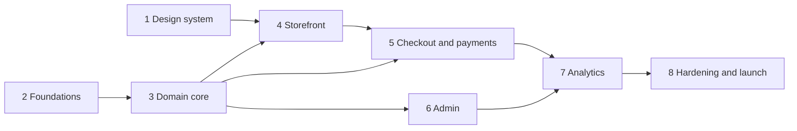

# ARGIVA build roadmap

This is the order of work after Phase 0. Each phase ends with a check by the owner before the next one starts. A detailed, step-by-step plan is written at the **start** of each phase, using what was learned in the phase before. The first one is ready: [Phase 1, design system](2026-10-31-phase-1-design-system.md) (done). Next: [Phase 2, foundations](2026-10-31-phase-2-foundations.md).

Decisions behind this plan: [docs/decisions.md](../decisions.md). Product and design guides: [PRODUCT.md](../../PRODUCT.md), [DESIGN.md](../../DESIGN.md). Live progress: [sdd/state.json](../../sdd/state.json).

## Rules for every phase

- Write the test first, watch it fail, then write the code (test-driven development).
- The agent never runs `git commit` or `git push`. The owner reviews and commits.
- Save progress to `sdd/state.json` after every task.
- Never invent prices, legal facts or tax rules. Use `TODO(owner)` placeholders and list them.
- UI code uses only `--argiva-*` design variables, never raw colour codes.
- Every screen is checked on phone, tablet and desktop, with the accessibility checker (axe), the design-quality checker (Impeccable) and Lighthouse.
- The last task of every phase is documentation, and the phase isn't done until it's finished. It updates:
  - [README.md](../../README.md);
  - [docs/setup.md](../setup.md), with any new accounts, services or owner steps;
  - [docs/runbook.md](../runbook.md), for operations;
  - a README for each new app or package;
  - ADRs;
  - [the docs index](../README.md).

## Phases

| Phase | What gets built | Done when | Needs from owner |
|---|---|---|---|
| **1. Design system** | `packages/ui` (shared screen components), fonts, motion, image rules and a preview app showing the home hero, product card and product page header in all three themes | Screenshots in 3 sizes × 3 themes pass axe and Impeccable; owner approves the look | Design review |
| **2. Foundations** | Next.js app `apps/web`, Turborepo, linting, typed config (`packages/config`), Docker image, Docker Compose (Postgres, local file storage), GitHub Actions CI, staging and production setup on Cloud Run, runbook | `docker compose up` runs the app locally; CI is green; staging deploys from `main` | Google Cloud and Neon accounts (free tier); GitHub repo settings |
| **3. Domain core** | Database schema and migrations (Drizzle), seed data, composition labels, pricing engine (fixed and silver-rate), order price snapshot, stock reservation | All domain rules covered by tests, including "a later rate change never alters an old order" | Silver-rate formula per purity, GST treatment, rounding rule (an example formula is used until then and is clearly marked) |
| **4. Storefront** | Home, collections, product page, filters, search, cart, Our Story, FAQ, contact and all policy pages (as drafts), SEO data, sitemap | Pages pass the checks on all sizes; mobile speed targets met (LCP < 2.5 s, INP < 200 ms, CLS < 0.1) | Product photos (placeholders until then), policy facts |
| **5. Checkout and payments** | Customer sign-in, addresses (India only), Razorpay payments behind `PaymentProvider`, webhooks, order emails, stock release on failure or timeout | Test-mode payment works end to end; repeated webhooks are handled safely | Razorpay test keys |
| **6. Admin** | Role and permission checks, audit log, products and media, silver rates with maker-checker approval, orders, packaging video and invoice, damage claims, re-polishing, policy pages, users and roles, appearance (theme) | Every action is tested against the permission matrix; price changes need a second approver | Names and roles of the first admin users |
| **7. Analytics and integrations** | PostHog events, admin dashboard (revenue, paid orders, average order value, funnel, bestsellers, slow movers, stock), WhatsApp chat button, Instagram links | Events show up in PostHog; dashboard figures match test data | WhatsApp number; Instagram handle confirmed |
| **8. Hardening and launch** | Security review (OWASP Top 10), full accessibility pass, speed tuning, end-to-end tests, backups, monitoring, domain and email setup, Razorpay go-live checklist, runbook | Launch checklist complete and signed off by the owner | Domain bought, trademark search done, legal name and address, Razorpay live approval |

## How the phases depend on each other

Phases 1 and 2 do not depend on each other. They run one after the other here so that the owner reviews one thing at a time.

## Where each requirement is built

| Requirement (from the scaffold prompt) | Phase |
|---|---|
| Product fields, catalog and variant model ([ADR 0006](../adr/0006-catalog-variant-model.md)) | 3, 6 |
| Silver composition labels (pure function, full tests) | 3 (badge display in 1) |
| Pricing engine and silver-rate history ([ADR 0007](../adr/0007-pricing-modes-order-snapshot.md)) | 3, 6 |
| Order price snapshot | 3 |
| Checkout: India-only, no COD, signed webhooks, stock reservation | 5 |
| Fulfilment video and invoice | 6 |
| Damage claims (2 days, video, replacement only) | 6 (customer form in 4) |
| Re-polishing requests | 6 (customer form in 4) |
| Admin and permissions ([ADR 0008](../adr/0008-admin-rbac-maker-checker.md)) | 6 |
| Filters that hide when there is no data | 4 |
| Analytics and dashboard | 7 |
| Policy pages as drafts ([ADR 0009](../adr/0009-legal-policy-pages.md)) | 4, 6 |
| Switchable themes ([ADR 0011](../adr/0011-design-direction-themes.md)) | 1, 6 |
| Typed config, no hard-coded values ([ADR 0012](../adr/0012-config-driven.md)) | 2 |
| Hosting, environments, backups ([ADR 0003](../adr/0003-cloud-hosting.md)) | 2, 8 |
| Security, speed, SEO, accessibility | Every phase; full pass in 8 |
